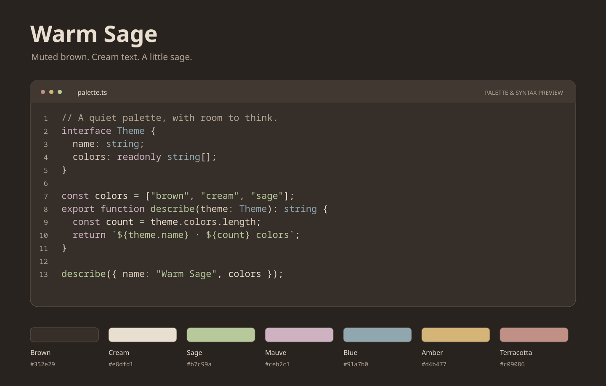

# Warm Sage for Zed

Muted brown surfaces, cream text, and sage accents, with matching syntax,
diagnostic, Git, and terminal colors.

This image illustrates the palette and syntax colors, rather than an editor screenshot.

## Install from the Zed extension registry

Once published, open Zed's Extensions view, search for **Warm Sage**, and install
the theme. Run **theme selector: toggle** and choose **Warm Sage**.

## Try the theme locally

Copy `themes/warm-sage.json` into `~/.config/zed/themes/`, restart Zed, and select
**Warm Sage**. Alternatively, choose **Install Dev Extension** from Zed's
Extensions view and select this `zed` directory.

## Source and feedback

The shared palette, matching VS Code and Firefox themes, and build tools live in the
[Warm Sage repository](https://github.com/SmallHusk/warm-sage-theme).
Please report problems through its issue tracker.

## License

MIT. Copyright (c) 2026 smallhusk.
